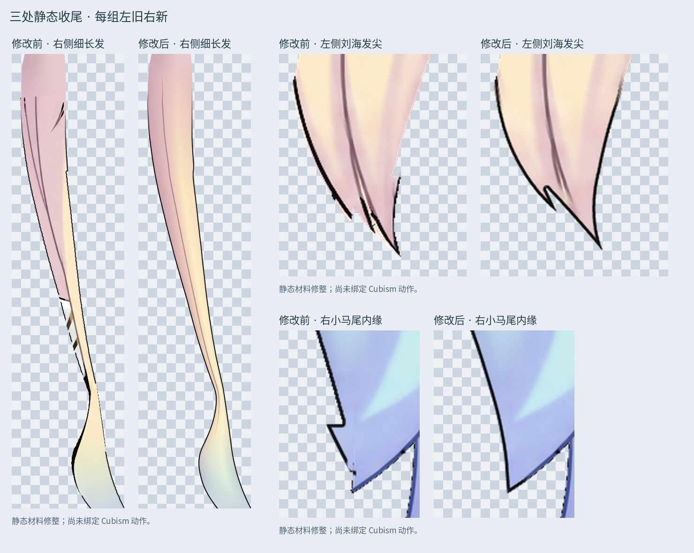
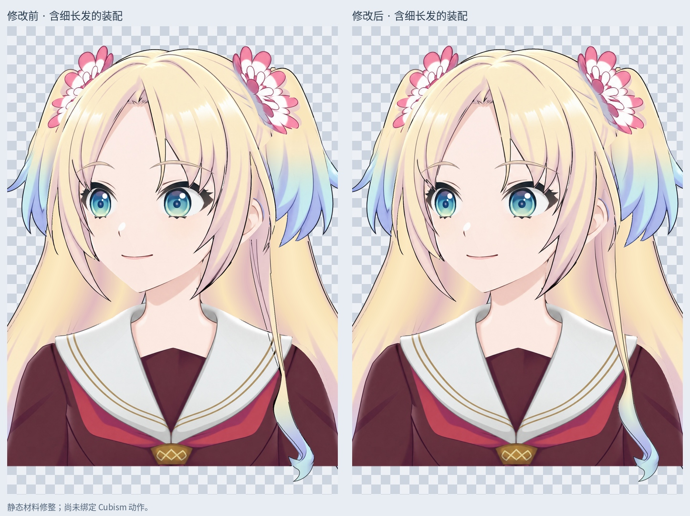

# 三处头发静态收尾

修正上一版检查中确认的三处问题：刘海左侧发尖白边 / 碎线、右小马尾内缘的直角台阶、右侧细长发中的白灰色残片与断线。

主文件：`Rurino_Three_Hair_Repairs_v034.psd`，3456 × 2816，55 个像素层。输入为上一版 55 层刘海与发根修正稿。

## 修改内容

- 左刘海：沿原发流重建末端曲线，保留不等长的小分叉；清理白边、碎线与小孔。同步眼前发片、独立黑线和下方局部肤色余量。
- 右小马尾：将内缘约 13 px 的直角突出修成平滑曲线，保留原有分叉。修正范围集中于该内缘，其他马尾发束未重画。
- 右侧细长发：修掉发干多处白灰色 / 黑色残片，沿弯曲的发片轮廓补画连续的粉金色到浅蓝色过渡；接回一条随发流变化的内部线，顺平发干边缘，保留下方原蓝色卷梢并清理边缘残线。
- 颜色和 `Ink_` 黑线仍分开编辑；没有新增任意矩形发块。

本轮修改 9 个已有像素层，其余 46 个图层逐像素保留，包括五官、独立眉毛、大马尾以及上一轮发根补底。没有新增图层。

## 检查

- 修改后的 9 层保存回读与透明 PNG 一致；其余 46 层 RGBA、偏移、透明度、可见性、混合和剪贴属性保持一致。
- 保存后的默认 PSD 合成与预览一致。
- 三个修正发片各保持一个主要连通区域，无封闭针孔。
- 已渲染并检查睁眼、半闭眼、闭眼；左刘海修边区域没有新增透明露底缝隙。
- 同时检查整头和带衣服的半身合成，避免只看头部漏掉细长发中的残片。

局部发边颜色、露出的肤色余量和细长发发干包含本地推断补画。当前只有左视图静态材料；尚未新增 Cubism 网格、动作关键形、头发物理或新运行模型。下一步应试绑定并检查转头、抬低头及身体侧摆时的露底和穿插。

输入 SHA256：`8cc7afed55ebd88bd417d76726ccdf82ed78d38ec81dc468164590ea2134bbe4`

输出 SHA256：`193051f38b35f894c2a5b50f6513beb6ecd86ddb665e3760888f627c5a293716`

## 使用与重建

直接打开主 PSD。默认开启 `02_Open`；半闭眼 / 闭眼仅单独开启对应眼型组。包内保留本轮输入 PSD、输入默认预览、脚本和验证记录。

安装 `production/requirements-materials-v034.txt`，依次运行 `python production/finish_three_hair_repairs_v34.py` 与 `python production/finish_three_hair_repairs_v34.py --build`。脚本依赖包内 `outline_hair_layers_v34.py` 的读写与合成工具；其他系统需调整该文件的 Noto CJK 字体路径。打开 PSD 不需要脚本。

