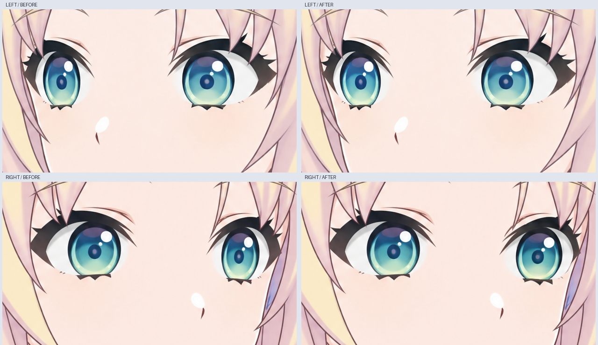
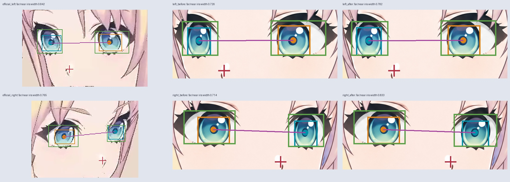

# 转头眼部校正：静态绘画参考

本轮将原视频的 56.4 秒、58.2 秒与左右重绘稿对照，检查远侧眼宽度、两眼间隔、鼻部相对位置及刘海遮挡。准确时间、原视频哈希和裁切坐标见 `reference-frames.json`。

**当前选用：左右转头图均已合入经过检查的远侧眼部局部重绘。** 左转先前四次整图编辑候选均未达到目标；本轮改用原图眼部的 512×512 裁切输入，成功得到较温和的局部修改，再合回原稿。左右转头仍是静态绘画参考，不代表连续转头透视或参数绑定已验收。

左转可见远侧虹膜宽度由 90 改为 97 像素，近侧保持 124 像素；虹膜质心仅偏移约 0.73 像素，可见填色区间隔保持 198 像素。没有仅为追求视频中的比例而移动双眼。眼睛原有位置与刘海前后关系保留，修订集中在远侧眼的可见体积。

右转仅采用第二次生成的眼部区域。可见远侧虹膜宽度由 90 改为 105 像素，近侧保持 126 像素；可见填色区间隔由 204 改为 187 像素，两虹膜质心距离由 357.99 改为 356.98 像素。这是减轻远侧眼过窄的绘画修订，不是按原视频比值拟合出的几何校准结果。

## 校正方法

通过 LibTV 局部重绘，再只把选中的眼部区域合入原侧向图。没有整体变形、镜像或按五官位置做局部拉伸。左转生成输出为 1024×1024，按原裁切框等比降采样回 512×512，并放回原坐标；这是输出像素分辨率统一，没有为改变眼形而做横向缩放、旋转或配准变形。右转使用与原稿相同分辨率的输出。眼部接缝采用 4 像素内侧羽化，原图 alpha 逐像素保留。完整提示词、任务、节点、下载回执与实际文件哈希保存在 `sources/`。

重绘结果必须先检查：第一次左右候选均把远侧虹膜画得更窄，未采用；第二次左转候选把远侧眼画得太宽且移得太靠近鼻子，也未采用；第三次左转候选又把虹膜画得过窄；第四次左转候选未拓宽虹膜。失败记录见 `qa/rejected-candidates.json`。当前左转采用单眼裁切重绘结果，右转采用第二次整图候选的眼部小区域。选用区域与源文件校验值见 `patch-selection.json`。

## 如何看检查结果

- `qa/eye-before-after.jpg`：每行一个方向，左列修改前，右列局部校正后。每对图片采用相同裁切与等比显示尺寸。
- `qa/eye-perspective-audit.jpg`：原视频、修改前、校正后三列。青/橙框是远/近侧虹膜，绿框是可见眼白与虹膜填色区域，红十字是手工标注的鼻部位置。
- `qa/eye-measurements.json`：可见虹膜宽度、填色区域间隔与鼻部相对位置。
- `qa/patch-verification.json`：区域外像素、整图 alpha、近侧眼、鼻嘴和下巴保护区域的逐像素比较。

这些数字是排查绘画问题的辅助依据。虹膜中心会随视线移动，并不是眼眶中心；填色边界也不等于被睫毛或头发遮住的真实眼角。视频与绘画的俯仰、视线和侧转角度不完全相同，因此不能将视频中的宽度比或眼距直接当作精确目标，也不能凭某一个比值宣称透视正确。

## 后续绑定约束

后续应分别建立左转、正面、右转的眼睑、虹膜与眼白关键形。眼距与鼻梁位置、远侧眼可见宽度和脸颊轮廓联动；眼球视线参数独立于头部转向。转头叠加眨眼时，需检查睫毛闭合位置、眼白遮罩、虹膜颜色与刘海前后关系。不能仅把双眼一同横移或缩放。

当前仅完成静态侧向绘画参考的局部修订。尚未拆层、与正面配准或绑定 Cubism；不能把完整图片切换或淡化当作连续转头。76 层正面 PSD 不因本轮改变，没有新增可运行模型。

上文路径均为源码 ZIP 内 `rebuild_v3_4/turn_redraw/eye_calibration/` 下路径。

