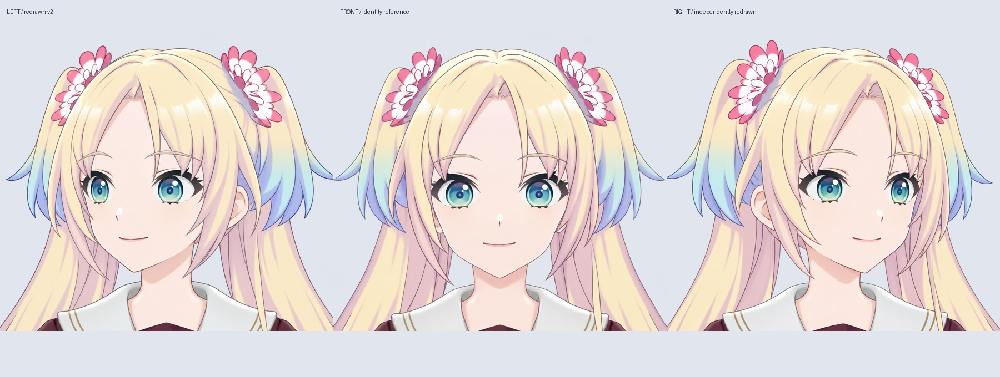

# v0.3.4 转头重绘参考（侧向眼部已拆层，尚未绑定）

当前阶段：[左侧可见部件拆层初稿](LEFT_HEAD_PARTS_V034.md)与[九方向领口对照](COLLAR_REGISTRATION_V034.md)，尚未完成精细切线、隐藏补画和绑定。以下旧阶段记录按历史理解。

最新阶段：[四角组合视角与九方向参考](CORNER_MATERIALS_V034.md)。四角绘画已补齐，完整拆层、配准和新绑定尚未完成；下文保留本阶段历史记录。

此前阶段：[上下俯仰结构参考](PITCH_MATERIALS_V034.md)。上下已补画，尚未拆层/绑定；四角组合关键形仍缺，先补齐整体转头结构。

最新阶段：[三视角眼部对应与组装素材](EYE_CORRESPONDENCE_V034.md)。统一图层语义、标记各眼部分闭眼锚点，保留原始图像和坐标；尚未完成几何配准或绑定。

最新侧向眼部成果：[左右各 20 层的眨眼关键形 PSD](SIDE_BLINK_MATERIALS_V034.md)；完整头部仍待拆分和绑定。

制作约束：用户明确要求“不要靠着拉伸转头”。此前基于正面图近似投影的转头方案已撤回；它的动画、控制网格和脚本不再放入当前源码包，也不作为后续转头依据。

## 当前路线

使用 LibTV Lib Image 2.5 Pro，以此前批准的正面头肩母图为身份参考，分别重绘朝画面左、右的头部。两边独立生成，没有通过翻转、斜切、液化、缩放正面脸来制造转头，也没有把一侧镜像成另一侧。提示词约束约 20° 侧转、头部直立、肩膀朝前，但模型实际角度未经过三维测量。

重点检查远近眼透视、鼻嘴朝向、下颌外轮廓、近侧耳朵显露和头发遮挡。原视频 57 秒的头部裁切也保存在 `reference/official-turn-57s.png`，用于目视复核造型和遮挡关系。

原始生成 PNG、完整提示词、模型参数、节点、任务与文件哈希在 `sources/`。主对照图为 `qa/turn-redraw-comparison.jpg`，选用文件与审阅记录见 `selection.json`。

## 眼部透视校正

新增原视频 56.4 秒和 58.2 秒的眼部对照、局部重绘选择及逐像素保护检查，见 [眼部透视校正记录](TURN_EYES_V034.md)。选中修改通过原坐标小区域合成；各方向的当前选用文件以 `selection.json` 为准。远侧眼宽度、可见眼白间隔和鼻部位置一起检查，不把某个固定眼距比例作为转头验收条件。

## 使用边界

左右方向新增独立的 10 层眼部 PSD，见 [侧向眼部分层](SIDE_EYE_MATERIALS_V034.md)：眼白、虹膜、上下眼睑已分离，并做小幅视线检查。眼睑边缘仍待收整，脸皮、耳朵、刘海和后发等完整部件尚未拆分，也没有与正面分层一一配准。不能直接切换这几张完整图冒充连续 Live2D 转头，不能用交叉淡化冒充参数变形。

下一步以审核后的侧向构图校准各部件关键形，补绘被遮挡的区域，再在 Cubism 内给各个部件建立相应参数与遮挡。Live2D 最终仍需要网格插值，但插值目标应来自各角度的正确绘画结构，而不是只对正面图做整体拉伸。

现有 `../expression_refinement/Rurino_Head_Expression_Materials_v034.psd` 是独立的 76 层正面表情工作稿，不含这里的侧面拆层。没有新增 cmo3/moc3 或 Windows 运行模型。

