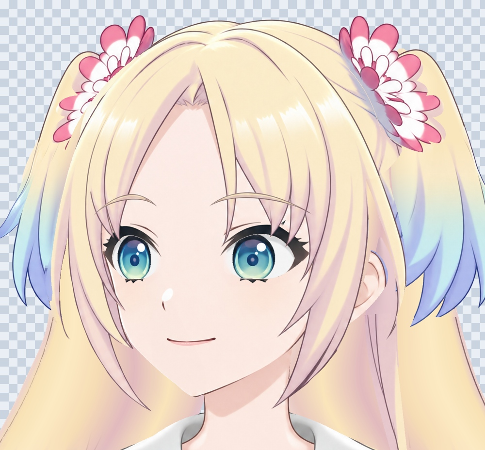
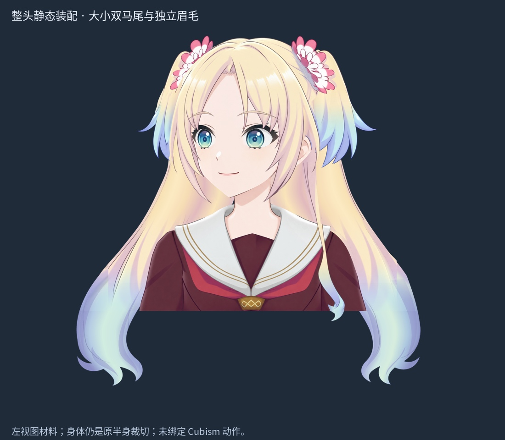
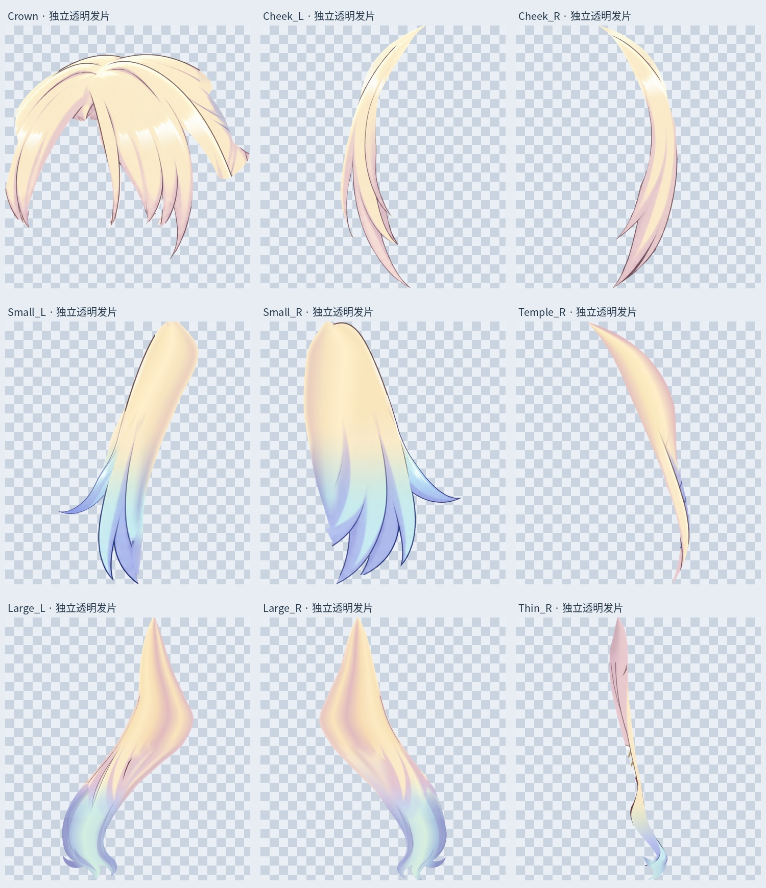
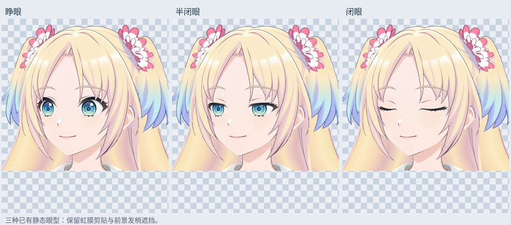

# 整头静态材料：四类修整与装配

本版将之前分散、默认隐藏的最新头发候选整理为一个默认可见的整头 PSD。四项静态工作已落实，文件打开后直接显示睁眼装配，不必手动叠加历史检查层。

| 本轮范围 | 已落实的修改 |
| --- | --- |
| 头顶 / 连续刘海 | 保持共同根部与中间刘海连续，清理右上旧补片接缝、内部针孔和孤立像素；恢复原先留在上下文中的额头皮肤边界，保留独立眉毛。 |
| 一对小双马尾 | 补花饰后根部与内缘余量，去除旧遮挡切线、台阶和重复残线，保留原有蓝色长短分叉；归还花饰顶部原轮廓碎片。 |
| 一对大双马尾 | 拓宽肩颈后的隐藏连接并重画断裂接缝；扩展画布，按各自发流补画末端弯曲分叉；右侧长细发的截断末端也一并补齐。 |
| 整头装配 | 最新发片只启用一份，补齐右花饰下漏空，恢复少量原始面部边界像素；检查三种静态眼型、虹膜剪贴、前景发梢遮挡以及浅底 / 深底边缘。 |

## 文件与图层

- 主文件：`Rurino_Whole_Hair_Static_v034.psd`，画布 **3456 × 2816**，**41 个像素层**。
- 原 2048 × 2048 坐标整体平移 **(+704, 0)**，没有缩放或拉伸五官。
- 9 个主要透明发片：`Crown`、`Cheek_L/R`、`Temple_R`、`Thin_R`、`Small_L/R`、`Large_L/R`。这是材料组件数，不是新增九缕发束或九套运动网格。
- 头顶与连续刘海仍共用 `Crown` 材料；本轮没有强行拆开共享区域。需要单独摆动时应在 Cubism 中按实际发流设计网格和变形器。
- `02_Open` 默认显示；`02_Half`、`02_Closed` 默认隐藏，切换时只启用一个眼型组。保留原虹膜剪贴关系。
- `04_Independent_Brows_Preserved` 是独立眉毛。`03_Hair_Over_Eyes_Preserved` 是已有的眼前发梢覆盖。
- `Face_Boundary_Underlap_SOURCE` 只恢复原图中少量漏接的面部边界像素，位于脸部下方；不是整脸替代图。来源 PNG 位于 `inputs/source-context-reference.png`。
- 旧 **134 层输入 PSD** 原样放在包内，保留所有历史候选以便回退；没有在新 PSD 里重复显示它们。

## 验证

- 41 个保存后图层与对应透明 PNG 逐像素一致，偏移正确。
- 29 个原始脸部、眼睛、眉毛、耳朵、身体及覆盖 / 皮肤上下文图层的 RGBA、偏移关系、混合、透明度、剪贴属性保持一致。
- 保存后的 PSD 默认合成与写入的合并预览逐像素一致。
- 睁眼、半闭眼、闭眼分别从实际 PSD 渲染并查看。
- 9 个发片按 alpha > 127、八邻域检查，均为单一连通部件，内部透明针孔为 0；没有发片接触新画布四边。
- 这些是静态材料 / 文件验证，不是转头、眨眼插值或物理验收。

## 补画来源与边界

隐藏根部与画布外末端是本地曲线绘制、颜色过渡和局部重绘的推断，不是恢复了原画不可见的像素。大马尾下段从原坐标 y=1750 起衔接推断末端，包含颜色及轮廓调整；不能称为完整保留该下段原画。末端发流参考本地官方全身图，并保留原视频链接作为造型依据：<https://www.youtube.com/watch?v=ltAEA_Lq5Js>。

这是当前**左视图**的静态材料稿。身体仍是原先裁到腰部的半身图，尚未补成全身。头顶共用区尚未独立绑定；没有新增 Cubism 网格、转头 / 抬低头关键形、身体左右侧摆 / 前后仰、头发物理或实时对话功能；旧 v0.3.3 运行模型没有被替换。

本轮未调用 LibTV 生成（此前服务返回不可重试的商业配置阻断）；没有把本地补画描述成 LibTV 输出。下一阶段是基于这些材料进行 Cubism 绑定，并在动作中继续验证隐藏余量与遮挡。

## 复现

打开 PSD 不需要运行脚本。若要重建，在包根目录安装 `production/requirements-materials-v034.txt`，运行：

```sh
python production/build_whole_hair_static_v34.py --repaint
```

脚本使用包内旧 PSD、原始边界来源 PNG、已记录的曲线路径。字体默认 Linux Noto CJK；Windows 上需修改 `FONT`。分块合成用于控制内存；输出依然是标准分层 PSD。

输入 SHA256：`af90791a4abf86fd286668dffc6727dd1278acc9a6f2324d1b5af0570048b882`

输出 SHA256：`fa43637c492dbb42c2efebe45d82459f1394523d5f5e9d0bf119c845e85fa11d`








